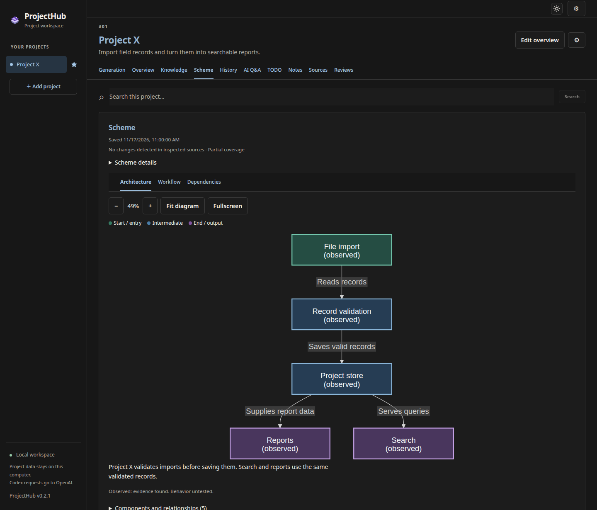

# ProjectHub


**Keep the context of a project across long AI conversations.**

When work is spread across several Codex sessions and ChatGPT chats, returning to a project means remembering what you tried, which approach you chose, and what still needs doing. ProjectHub collects that history in one local workspace and helps turn it into a useful project overview, searchable explanations, and diagrams.

Use it for software, research, or other projects with a growing conversation history.

## What you can do

- **Connect your project history.** Link terminal Codex sessions and import public ChatGPT shared conversations. Browse saved messages; inherited messages in forked sessions are collapsed without deleting the originals.
- **Understand where the project stands.** Project Overview gives the general picture. Knowledge Summary explains extracted choices, requirements and their reasons. Open the **Generation** tab to select what to refresh. Validated results save automatically, with links to original sources and previous versions.
- **Remember choices and their reasons.** Extract requirements, approaches, and decisions discussed in conversations into searchable Knowledge and AI Q&A. Knowledge retains documented parameter defaults, reported overrides, and project-specific trade-offs. Ask questions such as “Why did we choose this approach?” or “What have we already tried?”
- **Browse by topic.** Use **Generate AI tags** to organize saved Knowledge or Q&A independently of main generation. Type a tag or browse descriptions and item counts to filter saved results. Browsing tags makes no AI request; tags organize records without changing their content or evidence.
- **See how the project works.** Select **Scheme** in the **Generation** tab to generate architecture and workflow diagrams. The Scheme tab shows diagrams, dependencies and code structure. Diagrams distinguish observed, proposed and uncertain components.
- **Keep frequent projects close.** Pin projects in the sidebar to keep them at the top.
- **Find information and keep follow-ups.** Search conversations, notes, tasks, and generated information. Save useful passages as Markdown notes; bulk-add, pin, complete, or mark TODOs as not planned.
- **Connect the history to the code.** Link a local Git repository to see its remote address, local and remote-tracking branches, tracked and untracked file counts, and recent commits. Compare the current branch with its saved upstream. View public GitHub issues. Repository inspection is read-only.
- **Continue with context.** Review project questions and prepare a context preview to send to a Codex session after confirmation.

Choose the Codex account, model, reasoning effort, and response instructions for each project. In Settings, choose a colour palette for the Portfolio theme. Light/dark mode and text size can be adjusted independently.

**AI runs when you request it.** Opening projects and searching saved information do not trigger model requests.


## Install and run

### Install from a source checkout

Requires **Linux, Python 3.11+ with venv, Git, and Node.js 22.18+ with npm**.
From a cloned or downloaded checkout:

```bash
bash scripts/install.sh
projecthub
```

Keep the checkout for this installation. If its launcher is outside your PATH,
run `bash scripts/projecthub` from the checkout.

### Optional: install a wheel

If you have a ProjectHub wheel, you can install it on Linux with **Python 3.11+**.
The wheel bundles the built interface and database migrations.

**With pipx**

```bash
pipx install ./projecthub_local-0.2.1-py3-none-any.whl
projecthub
```

If the launcher is outside your PATH, run `pipx ensurepath` and reopen the terminal.
If you already have a source launcher named `projecthub`, the virtual environment
option below lets you try the wheel alongside it.

**With pip in a virtual environment**

```bash
python3 -m venv projecthub-venv
./projecthub-venv/bin/python -m pip install ./projecthub_local-0.2.1-py3-none-any.whl
./projecthub-venv/bin/projecthub
```

Use the wheel filename you downloaded. Install Git for repository inspection and
Codex for AI features. Both installation paths use the same [saved data directory](#your-data).
See [building a wheel](docs/README.md#build-a-wheel) if you work on ProjectHub itself.

Open **http://127.0.0.1:8766** after starting ProjectHub. Stop with Ctrl+C.

## Example: Get back up to speed on Project X

1. Click **Add project**, name it **Project X**, and link its local Git repository if you have one.
2. In **Sources**, link a Codex session about Project X or use **Import shared chat** to add a past discussion.
3. In **Generation**, select **Overview** and **Knowledge**, then click **Regenerate selected**. Read the saved result and follow its citations to the original discussions.
4. When you return, open **Reviews → Ask Project** and ask “Why did we choose to validate records before importing them?” or “Which export options did we discuss, and what is still undecided?” With the optional Codex skill, you can also ask “Read ProjectHub context for Project X before we continue.”
5. In **Generation**, select **Scheme** and click **Regenerate selected**. Open **Scheme** to explore the architecture, workflow, and dependencies.



## Settings and AI

Run `projecthub config` to locate your editable configuration. See [config.example.toml](config.example.toml). Environment variables override file settings; restart after changes.

When started with `projecthub`, use **Settings → Restart ProjectHub** to load backend changes. Restart is blocked during active work. After reconnecting, **Reload page** loads interface changes; save unfinished edits first. Direct Uvicorn launches use their existing external process controls.

AI features use your existing **Codex ChatGPT sign-in**. Install Codex separately and run `codex login`. No OpenAI API key is required. Open **AI settings** in the project header to choose a profile, model, and reasoning effort or edit project AI instructions.

ProjectHub runs locally. AI generation sends selected project context to OpenAI when requested. See [AI settings and generation](docs/AI_GENERATION.md) for progress, cancellation, and available settings.

### AI limitations

- **Long histories:** Analysis uses bounded context and may miss details. Follow source references to check conclusions.
- **AI accuracy:** Generated architecture and current-work summaries are interpretations, not proof that features work or scientific results are valid.

Open **Coverage** below a generated result to see what evidence was included and what was missed.

## Terminal-agent skill

The optional Codex skill lets a terminal agent read project context and manage notes,
TODOs, and session links on request. Run `projecthub install-skill` to enable it.
With ProjectHub running, open a new Codex session and try these prompts:

- “Read ProjectHub context for Project X.”
- “Save this explanation as a note in Project X.”
- “Add a TODO to Project X: test the import.”
- “Mark ‘test the import’ finished in Project X.”
- “Link this session to Project X.”
- “Unlink this session from Project X.”
- “Find all codex sessions related to X and link them to Project X.”

<details>
<summary>Optional terminal commands</summary>

Run these directly if you want to read the same project context outside a Codex session.

```bash
projecthub context --project 'Project X'
projecthub read --project 'Project X' --kind knowledge
```

</details>

See the [terminal-agent guide](docs/TERMINAL_AGENTS.md) for installation options and commands.

## Your data

Settings default to `~/.config/projecthub/config.toml`; project data to `~/.local/share/projecthub`. Back up the data directory to preserve saved history, notes, and tasks.

[User guides and developer documentation](docs/README.md) · [Changelog](CHANGELOG.md) · [MIT license](LICENSE)

Made with Codex :)
