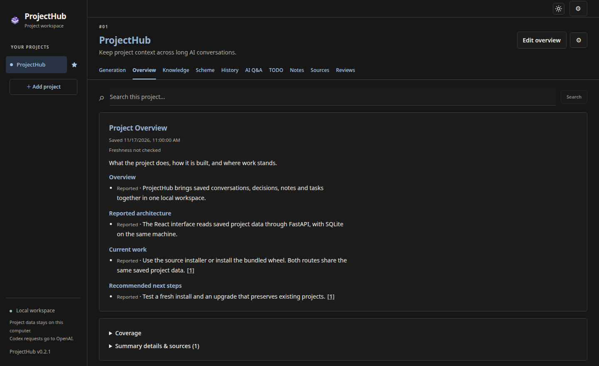

# ProjectHub


**Keep the context of a project across long AI conversations.**

When work is spread across several Codex sessions and ChatGPT chats, returning to a project means remembering what you tried, which approach you chose, and what still needs doing. ProjectHub collects that history in one local workspace and helps turn it into a useful project overview, searchable explanations, and diagrams.

Use it for software, research, or other projects with a growing conversation history.

## What you can do

- **Connect your project history.** Link terminal Codex sessions and import public ChatGPT shared conversations. Browse saved messages; inherited messages in forked sessions are collapsed without deleting the originals.
- **Understand where the project stands.** Generate an overview of its purpose, architecture, current work, unresolved problems, and suggested next steps. Follow source references and revisit previous versions.
- **Remember choices and their reasons.** Extract requirements, approaches, and decisions discussed in conversations into searchable Knowledge and AI Q&A. Ask questions such as “Why did we choose this approach?” or “What have we already tried?”
- **Browse by topic.** Use **Generate AI tags** to organize saved Knowledge or Q&A independently of main generation. Type a tag or browse descriptions and item counts to filter saved results. Browsing tags makes no AI request; tags organize records without changing their content or evidence.
- **See how the project works.** Generate architecture and workflow diagrams in Scheme, inspect dependencies, and browse the code structure. Diagrams distinguish observed, proposed, and uncertain components.
- **Find information and keep follow-ups.** Search conversations, notes, tasks, and generated information. Save useful passages as Markdown notes; bulk-add, pin, complete, or mark TODOs as not planned.
- **Connect the history to the code.** Link a local Git repository to inspect branch, recent commits, tracked changes, and untracked files. View public GitHub issues. Repository inspection is read-only.
- **Continue with context.** Review project questions and prepare a context preview to send to a Codex session after confirmation.

Choose the Codex account, model, reasoning effort, and response instructions for each project. Adjust text size and color theme for comfortable reading.

**AI runs when you request it.** Opening projects and searching saved information do not trigger model requests.



## Install and run

Requires **Linux, Python 3.11+ with venv, Git, and Node.js 22.18+ with npm**. From a cloned or downloaded checkout:

```bash
bash scripts/install.sh
projecthub
```

Open **http://127.0.0.1:8766**. Stop with Ctrl+C. If the command is outside your PATH, run `bash scripts/projecthub`. Keep the checkout: the launcher links to it.

## Settings and AI

Run `projecthub config` to locate your editable configuration. See [config.example.toml](config.example.toml). Environment variables override file settings; restart after changes.

AI features use your existing **Codex ChatGPT sign-in**: install Codex separately and run `codex login`. No OpenAI API key is required. Choose an existing profile, model, and reasoning effort in Settings; edit project AI instructions there too.

ProjectHub runs locally. AI generation sends selected project context to OpenAI when requested. See [AI settings and generation](docs/AI_GENERATION.md) for progress, cancellation, and available settings.

## Your data

Settings default to `~/.config/projecthub/config.toml`; project data to `~/.local/share/projecthub`. Back up the data directory to preserve saved history, notes, and tasks.

[User guides and developer documentation](docs/README.md) · [Changelog](CHANGELOG.md) · [MIT license](LICENSE)
