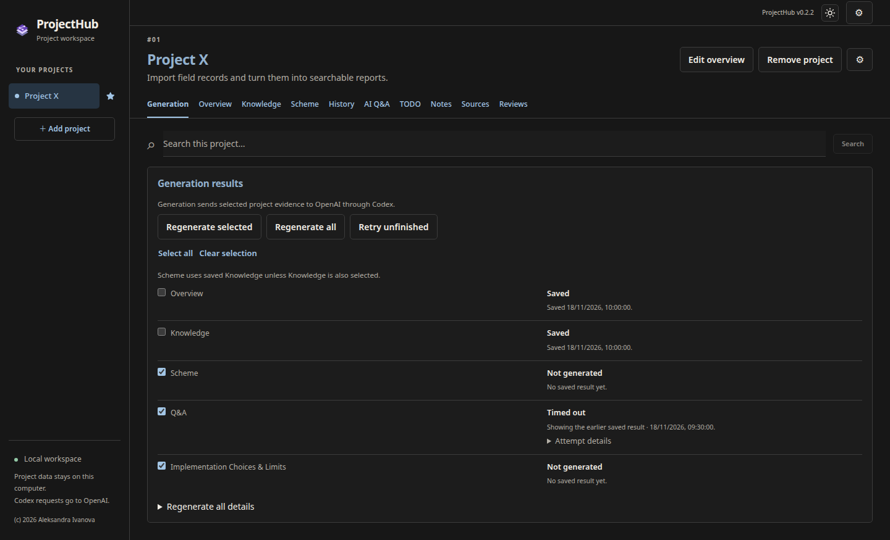
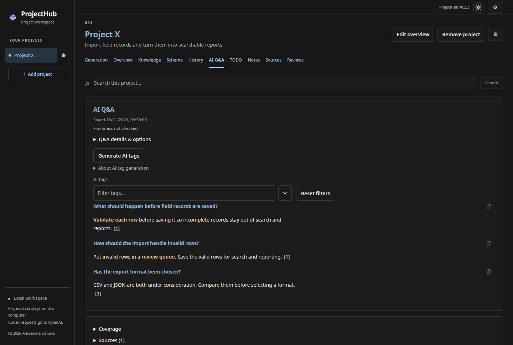

# AI generation

Generation sends selected project evidence to the chosen AI provider. Browsing and searching use
local data. Follow source links to check claims against the original evidence.

## Generate or retry

Open **Generate**, select the views you want, and click **Regenerate selected**.
Results save automatically after validation. Use **Previous versions** where
available to open earlier results.

- **Regenerate all** runs available views in parallel. When both Scheme and
  Knowledge are queued, Scheme starts after Knowledge saves successfully. Scheme
  can run on its own using saved Knowledge, when available.
- **Retry unfinished** reruns missing or unsuccessful views and saved results with
  recoverable gaps, such as omitted batches or a Q&A ranking fallback. Saved
  results remain visible. If the retry includes both Knowledge and Scheme,
  Scheme waits for Knowledge to save.
- **Generate AI tags** is a separate action on saved Knowledge and Q&A.

See [Project Overview and Knowledge](PROJECT_KNOWLEDGE_UI.md) and
[Scheme](SCHEME.md) for the individual views.

## Read saved Q&A

Open **AI Q&A** to read answers from saved evidence and follow their citations.

## Progress, cancellation and timeouts

Progress shows the stage, completed batches and cache reuse when available.
The running token count adds the totals reported so far and shows how many model
requests supplied a total. Codex can report during a request. Claude Code
usage arrives with completed responses when available. Requests without a
reported total are left out.
**Cancel generation** may take time to reach an active request. Failed and
cancelled runs preserve earlier saved results. Attempt details retain the last
stage and batch counts after a restart. Claude quota errors show the reset time
when the provider supplies it in a recognized format.

After a timeout or interruption, click **Retry unfinished**. Views with batch
caches can reuse completed batches that match the current inputs, even after a
server restart. A Scheme retry can reuse local inspection results and sends a
fresh model request. Reload the page to reconnect to a run still active on the
same server.

Knowledge can reuse completed batches after switching Codex accounts when the
model and reasoning effort are both explicitly set and the inputs still match.
Runs with Codex defaults use account-specific caches.
Knowledge retries a confirmed temporary service or response-stream failure once
within the same time budget. Usage limits and authorization failures end the attempt.

**Settings → Overall time budget (seconds)** allows 30 to 7,200 seconds per run,
with a default of 900 (15 minutes). Each response also has a separate timeout.

If a conversation summary fails output validation, ProjectHub retries that batch
twice and continues with the other batches. It rechecks deferred batches if time
allows. A result can save with clearly marked partial coverage when the remaining
omissions are small and every affected conversation still has cited evidence.
Generation details list skipped batches. The next refresh reuses valid batches
and can try the missing ones again.

Q&A reuses completed drafts and rankings. During ranking, AI selects from IDs
for validated draft answers. ProjectHub attaches those answers, their recorded
alternatives, and their original citations. If ranking output still fails
validation after retrying, ProjectHub can use the validated drafts in their
existing order and record the fallback in coverage details. The next refresh
retries those rankings while reusing successful drafts and rankings.
Raise the overall budget if a run needs more time across stages. For stalled
requests, try a different model or reasoning effort.

## Settings for quality and resource use

### AI provider

Choose **Codex** or **Claude Code** in the project's AI generation settings.
Claude can generate Overview, Knowledge, Scheme, Q&A, Ask Project answers,
Implementation Choices & Limits, and tags. Selected generation evidence goes
to Anthropic when Claude is selected. Codex still handles linked Codex sessions
and their history.

### AI profiles

An AI profile lets ProjectHub use an existing CLI sign-in. Open **Settings → AI
profiles** to check Codex and Claude Code or choose **Add AI profile**. Give the
profile a name and enter the absolute path to its configuration directory. This is the directory configured by
`CODEX_HOME` for Codex or `CLAUDE_CONFIG_DIR` for Claude Code. Install the relevant
CLI and sign in with `codex login` or `claude auth login` using that directory and
the same OS user who runs ProjectHub.

Select a registered profile in the project's AI settings. The launch account is
also available for each provider. Claude Code generation uses the selected Claude
account, while linked Codex sessions continue to use Codex. ProjectHub disables
Claude tools and session persistence for generation. Organization-managed Claude
Code settings still apply.

### Conversation review depth

Choose the depth in **Settings**. It controls how ProjectHub reviews conversation
history, including how Knowledge batches or selects original messages.
Implementation Choices & Limits uses code and configuration.

| Profile | When to use it |
| --- | --- |
| **Thorough** (default) | Knowledge reads available original messages in smaller batches to retain detail. |
| **Balanced** (experimental) | Shares the message budget across conversations and skips imported tool logs. Overview and Q&A use saved conversation overviews. Knowledge reads selected originals in larger batches. |
| **Summary-assisted** (experimental) | Reuses conversation overviews and builds missing ones. Knowledge uses them to select original passages within its source budget. |

Summary-assisted builds overviews from the saved Codex history index and imported
conversations. Building missing overviews can take extra time and tokens. Later runs reuse
matching batches across reviews. Refresh History to include recent Codex messages
if the index is out of date. Check Coverage for missing sources and omitted text.

When indexed history exceeds the standard text budget, all depths share the
intake across conversations. This keeps one long session from using the entire
budget. Overview and Q&A reuse saved conversation overviews. Overview also
considers bounded, source-linked published Knowledge and relevant repository
excerpts. Recognized imported tool logs remain searchable in History. Coverage
shows when the limits leave other original material out. Use **Search original
conversations** in Knowledge to find material directly in the local index.

Explicit model and reasoning settings take precedence. Summary-assisted can use low
reasoning by default when the selected model supports it. Changing the profile,
model or instructions can require fresh processing.

### Scheme focus for next run

Choose a focus in **Scheme** or **Generate → Scheme**. It controls what the
diagrams emphasize. **Balanced** (default) combines code and discussions,
**Code first** emphasizes the current implementation, and **Sessions first**
emphasizes decisions, reasons, and proposed workflows.

If Scheme is queued behind Knowledge, it keeps the focus selected when you
started the run. [See how Scheme uses evidence.](SCHEME.md#generate-or-refresh)

### Other settings

**AI workers per job** limits parallel batches for each job. The default is 10.
Set it to 1 to run batches in sequence, or lower it if you hit memory or account
limits.

Settings save automatically and apply to the next run. Startup environment
overrides can take precedence after restart. See the
[configuration example](https://github.com/avnikonenko/ProjectHub/blob/main/config.example.toml). Scheme has separate
[inspection and excerpt settings](SCHEME.md#freshness-and-coverage).

## Check coverage and costs

Expand **Coverage** below a generated result.

- **Files used and missed** shows supplied excerpts and omissions. A local file
  read may contribute only an excerpt to generation.
- **Detailed coverage** shows conversation and repository counts, scope and limits.
- **Processing diagnostics** shows recorded timing, workers, cache reuse and
  token usage. Token totals can be partial.

Older results may have fewer measurements. Check cited passages to judge accuracy.

**Files were skipped?** In Scheme, open **Coverage → Files used and missed**
and match the omission reason to its [budget setting](SCHEME.md#freshness-and-coverage).
For **Source excerpt budget reached**, try **60,000** or **80,000** characters
under **Settings → Scheme excerpt budget**, then regenerate. Larger budgets can
increase generation time and token use. Repository exclusions still apply.

## History sync

ProjectHub checks linked Codex history locally about once a minute by default.
Pause a session's sync in **Sources** or refresh it manually from **History**.
Imported ChatGPT shares stay as saved snapshots. See the
[configuration example](https://github.com/avnikonenko/ProjectHub/blob/main/config.example.toml)
for sync settings.

Contributors can find extraction, synthesis and diagnostic details in the
[Knowledge pipeline reference](KNOWLEDGE_PIPELINE.md).
