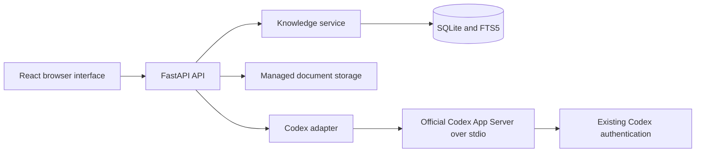

# ProjectHub architecture

## Scope and assumptions

ProjectHub is a single-user Ubuntu application. FastAPI serves a React/TypeScript interface and a project-scoped HTTP API from one loopback origin. SQLite is the durable source of project knowledge; Codex is optional. The requested stack authorizes the necessary application dependencies. No unrelated repositories, existing Codex sessions, credentials, or global configuration are edited.

The MVP keeps Codex read-only. A decision acceptance changes knowledge, never execution permissions. A future code-edit mode must have a separate explicit approval workflow.

## Components

The backend creates one SQLAlchemy engine and transaction-scoped sessions. Alembic owns schema versions. Database foreign keys are enabled on every connection. The default data directory follows XDG (`$XDG_DATA_HOME/projecthub`, falling back to `~/.local/share/projecthub`); an explicit directory override supports isolated tests and portable deployment. Mutable user data is never placed in the source tree by default.

The frontend requests a project overview bundle and uses project-scoped mutations. Switching projects clears selection and form state before loading another bundle. User-supplied Markdown and Mermaid must not execute raw HTML, scripts, links with unsafe schemes, or Mermaid click handlers.

## Evidence and history

Overview freshness compares a fingerprint of project metadata, scoped records,
linked-session metadata, indexed history, and local Git observations. Read timestamps
are excluded. Bounded hashes of visible changed files detect subsequent edits to the
same path without sending file contents to Codex during a freshness check. The
baseline is captured before synthesis and saved with the result and its revision.
Inspection errors or incomplete changed-file detection can make freshness unknown.
Git inspection uses bounded, read-only commands without filters, hooks, remote
fetches, or project test commands.

History can collapse identical indexed prefixes within a project. In a confirmed
shared prefix, finished turns match by normalized user/assistant message text,
roles, and order. Deduplication stops at divergence, stale indexes, or unreadable
rows. It leaves original sessions and per-session search results intact.
Generation can reuse cached summaries of the canonical prefix and attach alternate
session references afterward. Retrieved excerpts from a shared turn are collapsed
only when their excerpt text matches.

## Knowledge lifecycle

### Independent Overview and Knowledge Summary

Project Overview retains its general brief generation and revisions. The existing
Knowledge extraction, reconciliation and synthesis pipeline produces detailed
Knowledge records and a Knowledge Summary. Publication atomically saves those in
`ProjectKnowledge.snapshot`, with the summary under `summary`, and appends a
Knowledge revision. It does not write the general `ProjectBrief` or brief revisions.
Each action has its own progress/cancellation identity and project/view lease.
Unrelated jobs can run together; a duplicate action is blocked. The lock-compatible
maintenance gate remains exclusive for restart and source/account changes.
Request-local managers isolate transports and model provenance. Saves retain their
own SQLite transactions and atomic cancellation checks. Legacy matching summaries remain recoverable.
Opening a view only reads saved results and lightweight progress/freshness data.
Q&A and Scheme remain separate generation actions. No checkpoint entities are added.

### Durable generation outcomes

`ProjectGenerationAttempt` stores one small latest outcome per project/view,
independently from output snapshots and revisions. Begin and terminal transitions
are persisted; batch updates stay in memory. Successful outcomes stage in the same
SQLite transaction as their result. Run-identity checks prevent stale workers from
overwriting retries. Startup marks abandoned running/waiting attempts Interrupted.
The read-only generation summary reads scalar artifact metadata and attempt rows;
it does not inspect repositories, load complete snapshots or call a model.

Scheme dependency waiting/skipped states are durable and are superseded only by
the matching queue outcome or a newer real Scheme attempt. Retry selection reuses
the normal generation actions and preserves the Knowledge-to-Scheme dependency.

### Implementation choices and project-specific limits

`parameter_evidence.py` performs bounded, read-only extraction from the registered
repository. Declarations, code/configuration defaults and bounded application-site
excerpts are deterministic facts; `parameters.py` makes one explicit Codex request
for separately labeled behavior, consequences and explanations. Non-parameter
findings must cite their recorded application evidence, not just a definition.
The model cannot replace parameter names, defaults or locations, and explanation
citations must refer to inspected evidence. No run execution or runtime-value
tracking is involved.

The UI leads with consequential findings and links separately to saved definition
and application snippets. Ordinary defaults and legacy snapshots remain available.
The endpoint and revision kind retain their `parameters` names for compatibility.

`GET/POST /api/projects/{id}/codex/parameters` reuse project ownership checks,
generation locks, cancellation/budgets and existing revision storage. Successful
snapshots append `GenerationRevision(kind='parameters')` atomically; the latest
revision is the saved view, so no new table or knowledge subsystem is needed.
Reads and client-side search never invoke Codex. Other saved project views are
untouched, and failures/source changes preserve prior parameter results.

### Legacy acceptance records

Answer acceptance is a single database transaction: validate ownership, preserve previous state, supersede any prior linked accepted decision, select the answer, resolve the question, create the new accepted decision, optionally create a task, and append an audit event. The overview and summary are derived from committed records, avoiding stale summary caches.

Reopening clears the question's current acceptance and supersedes the previous linked accepted decision. It preserves answers, decision records, and audit snapshots. Editing accepted decisions must preserve before/after snapshots in audit history. Scientific hypotheses remain notes or proposed decisions until a user explicitly accepts them.

## Codex boundary

The adapter discovers the executable and interrogates installed protocol capabilities. It uses documented App Server JSON-RPC messages, with an initialization handshake, request correlation, timeouts, event handling, and process cleanup. New ProjectHub sessions use read-only sandbox settings and refuse permission elevation. Existing sessions may be associated only after explicitly selecting and resuming a supported session; the application never rewrites history files.

Context packages contain project metadata, relevant accepted decisions, unresolved questions, and task data. Their exact bytes and hash are persisted before submission. Decision delivery has separate queued, submitted, completed, and failed states: a local database change is never evidence of delivery. A preview is reviewed before sending, and updates remain queued while the target session is busy or unavailable. AI responses can be saved as proposals and require human verification.

## Local security

Bind to `127.0.0.1`. Validate Host and browser Origin to reduce DNS rebinding and cross-origin request risks; serve frontend/API from one origin. No arbitrary shell command endpoint exists. Repository registration resolves an absolute existing directory, validates it with Git using argument vectors and a timeout, and reads metadata without modifying files. Uploaded documents have size/type limits, server-generated storage names, restrictive permissions, and symlink-safe creation. Treat their text as untrusted data in both UI and context packages.

Backups use SQLite's backup API for a consistent snapshot. JSON export contains only the selected project's records. Record deletion never deletes a registered repository.

## Ownership and integration

- Architect: architecture, model, API contract, implementation plan and design decisions.
- Backend: `backend/app/` except Codex adapter; `backend/tests/` except integration tests.
- Frontend: `frontend/src/` and `frontend/tests/`.
- Codex engineer: `backend/app/integrations/codex/` and its tests.
- Coordinator: shared packaging/configuration, startup, integration and final review.
- QA: independent integrated tests and security/test reports after implementations converge.

Core interfaces precede dependent implementation. No agent edits another owner's files without coordination. Concurrency is limited to three implementation workers.
