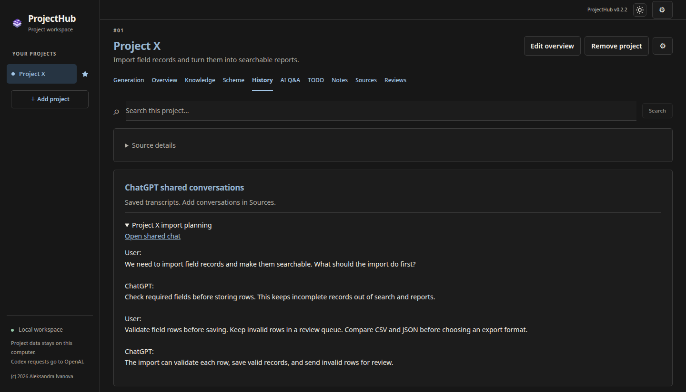

# Project evidence and freshness

Refresh the project summary from **Generation → Overview → Regenerate selected**.
Open **Overview** for the result, citations, **Coverage**, and **Previous versions**.

## What Overview uses

Overview can use project metadata, notes, TODOs, linked Codex history, imported
conversations, and Git excerpts. Generation sends selected evidence to Codex.
Browsing and freshness checks use local data without running code or tests.

Read-only repository inspection skips ignored untracked paths, submodule
contents, generated directories, and common private files. To exclude
additional paths, set `PROJECTHUB_EVIDENCE_EXCLUDE` before startup.

```bash
export PROJECTHUB_EVIDENCE_EXCLUDE='["private/**", "data/**"]'
projecthub
```

Saved notes and conversations remain eligible.

## How to read freshness and coverage

- **Freshness** compares available evidence with the saved result. **No changes
  detected in inspected sources** applies to that comparison. Unavailable sources
  or inspection limits can leave freshness unknown. A result can become stale
  during generation. Failed updates keep the last successful result.
- **Coverage** lists the evidence considered. Overview labels repository
  observations, reported claims, inferences, and open issues. A missing test
  result means ProjectHub has no recorded result to cite.

## Read saved conversations

Open **History** to expand an imported transcript or select a linked Codex
session.



## Shared history in forked sessions

History can collapse matching opening turns from linked forks. Search can still
find each copy. The comparison uses indexed conversation text, leaving tool
output and attachments outside its scope. Turns stay separate after a fork diverges.

See the [architecture reference](ARCHITECTURE.md#evidence-and-history) for details
on freshness checks and shared history.
