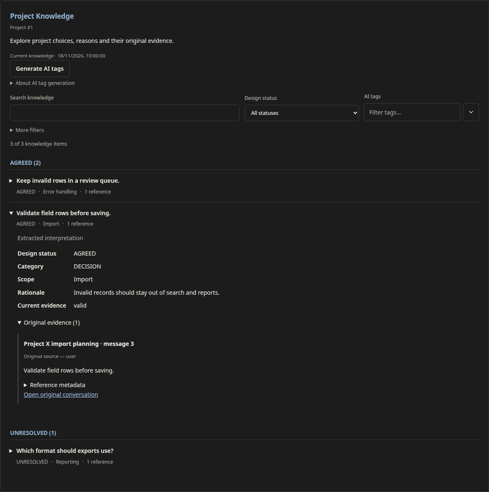

# Project Overview and Knowledge

- **Overview** summarizes the project's purpose, architecture, current work
  and next steps.
- **Knowledge Summary & records** shows extracted choices, requirements, reasons
  and original evidence.

Each view has its own saved result.

## Use

Open **Knowledge** and use **Search knowledge** to narrow the list. Project-wide
search finds saved records across views.

- Filter by **Design status** or open **More filters** for **Category** and
  **Scope**. Type a scope or pick a suggestion.
- Expand a record for reasons, exact evidence and related records. Open
  **Interpretations from the same passage** for individual records that share
  evidence.
- Use **Show more** in long groups and **Reset filters** to start over.

**Coverage** lists the inputs recorded for the saved result. **Current source
availability** shows which originals you can check now. Saved excerpts remain
readable if the original source becomes unavailable. Previous Knowledge versions
show evidence status at the time of generation and retain saved excerpts.

## Generate and use a result

In **Generate**, select **Overview**, **Knowledge**, or **Implementation
Choices & Limits**, then click **Regenerate selected**. Return to the view to
read its saved result. **Previous versions** lets you browse saved results.
Choose a version, then select **Use this version** to make it active.
**Unpublished Knowledge previews** shows the latest legacy preview when available.

Generation uses the project's Codex account, model, reasoning effort and
instructions. See [AI generation](AI_GENERATION.md) for progress, cancellation
and retries.

## Implementation Choices & Limits

Open **Knowledge → Implementation Choices & Limits** to inspect code caps,
filters and fallbacks. Expand a finding to see saved declaration and usage
excerpts. The view separates code defaults, configuration declarations and
inferences. Runtime values can differ.

Inspection reads Python and simple values in JSON, TOML and YAML, excludes
sensitive declarations, and leaves repository code untouched. Check **Coverage**
for gaps. Search and filter saved findings by component, or open
**Generation & saved versions** for earlier results.

## AI topic tags

Choose **Generate AI tags** on saved Knowledge or Q&A. Tagging preserves records
and evidence. Failed or cancelled runs keep existing tags.

- Type a tag or use **Browse tags** for descriptions and counts.
- Items can have several tags. Each tag count is calculated before other filters
  apply.
- Choose **All items** to clear the selection or **Untagged** to find records
  without tags.

For API and implementation details, see the
[contributor reference](KNOWLEDGE_UI_INTERNALS.md).
