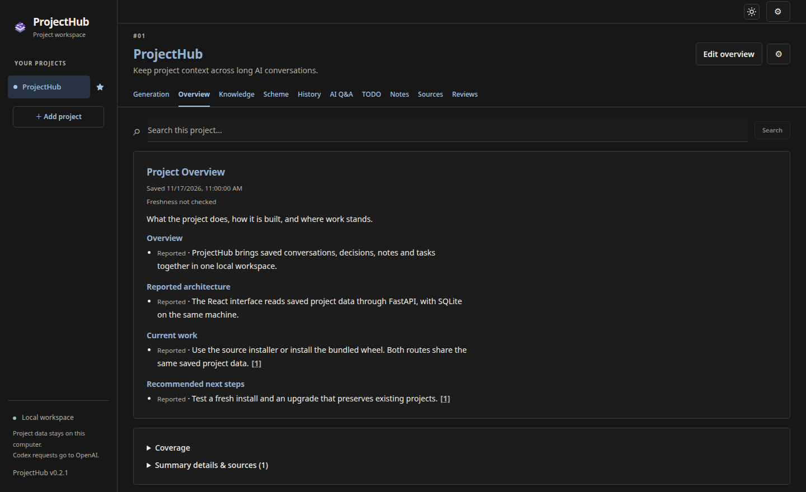

# ProjectHub

**Keep your project knowledge organized and accessible across AI conversations and development sessions.**

On long-running projects, important information often ends up spread across Codex
sessions, ChatGPT conversations, and Git repositories. When you return to a
project, it can be hard to find what you decided and why.

**ProjectHub** is a local workspace that brings this information together.

## What you can do

- **Preserve knowledge.** Capture decisions, requirements, reasoning, and unresolved questions with links to original conversations.
- **Understand your project.** Generate overviews, searchable knowledge, Q&A, and diagrams of architecture, workflows, and dependencies.
- **Explore previous work.** Search conversations to see why decisions were made. Inspect a linked Git repository to see how features were implemented.
- **Continue with context.** Preview relevant project knowledge before sending it to a Codex session so you can build on previous work.
- **Stay organized.** Manage projects, notes, TODOs, and related conversations in one workspace.

Designed for developers, researchers, and anyone working on long-running projects with AI assistance.

## Use and configuration

- [Install ProjectHub and start a project](GETTING_STARTED.md)
- [Generate, refresh, or retry results](AI_GENERATION.md)
- [Browse Overview and Knowledge](PROJECT_KNOWLEDGE_UI.md)
- [Read diagrams and dependencies in Scheme](SCHEME.md)
- [Check evidence and freshness](PROJECT_EVIDENCE.md)
- [Use ProjectHub from a terminal agent](TERMINAL_AGENTS.md)

[Developer reference](DEVELOPER_HOME.md)
