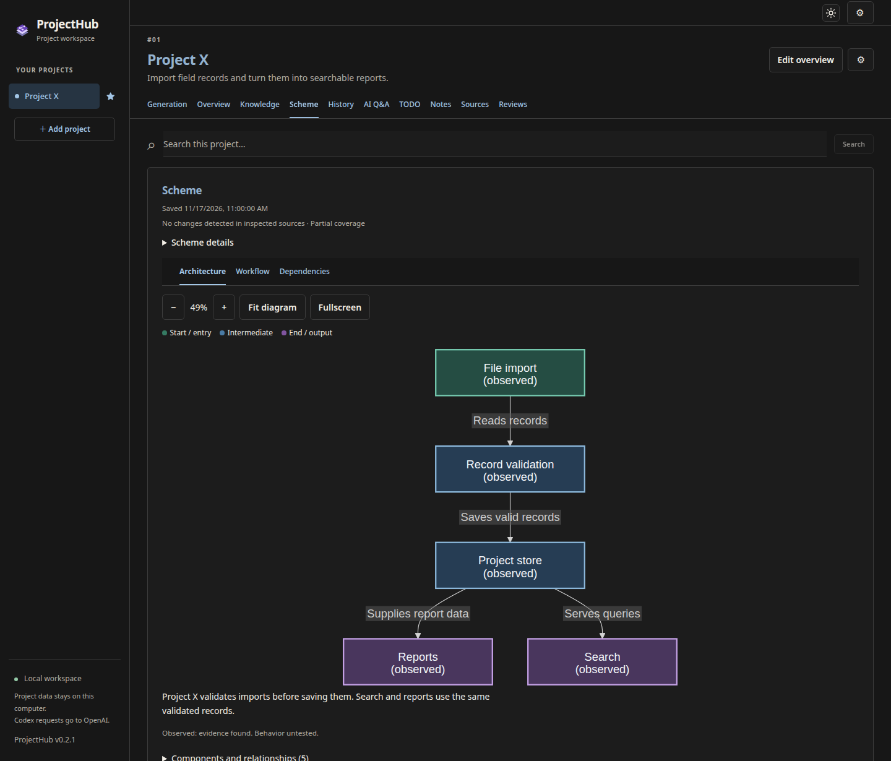

# Scheme

Scheme shows a project's components, workflows, and dependencies. Browsing saved
results makes no AI request.

## Views

- **Architecture** shows components and relationships. Expand **Code structure**
  for the selected repository tree.
- **Workflow** shows stages, inputs, outputs, and execution order.
- **Dependencies** shows tools, libraries, declared versions, and their roles.
- **Focused Scheme** diagrams a specific part of the project from an instruction you provide.

Component labels indicate **observed**, **proposed**, or **uncertain** status.
An observation has supporting evidence. Verify runtime behavior separately.
General Scheme keeps method stages concise. Open the cited sources or use
Focused Scheme for parameter details. A branch description may mention
experimental status or a validation gap when the cited evidence supports it.
Green marks entries, purple marks outputs, and blue marks other components.

## Generate or refresh

1. Use **Edit overview** to link a repository, if available. Link conversations
   through **Sources**.
2. Open **Scheme**, choose a focus, then click **Generate Scheme**. Choose
   **Balanced** for an even view, **Code first** for the current implementation,
   or **Sessions first** for decisions, rationale, and proposed workflows.
3. Open **Scheme** and expand **Components and relationships** or **Evidence
   used** to check the supporting excerpts.

Generation sends selected evidence to the provider chosen in the project's AI settings.

Under **Settings → Advanced settings → Scheme**, set **Maximum nodes** (1 to
60, default 20) and **Maximum edges** (0 to 120, default 40). The limits are
independent and apply per diagram to Architecture, Workflow, and Focused Scheme.
Set the edge limit to zero for a diagram with nodes only. Wait for the save
confirmation before starting the next Scheme generation.

The result records its focus. You can also choose it in **Generate → Scheme**.
When you run Knowledge and Scheme together, Scheme uses that choice after Knowledge saves.
Focus leaves the repository dependency scan independent of the diagrams.
General Scheme prioritizes declared commands, their code handoffs, and
referenced configuration sections alongside project guides. Longer entrypoint
files can use a larger per-file read within the same overall inspection budget.
General Scheme also reserves part of that budget for matching full-text index
declarations, trigger writes, and application queries when found in the repository.
It can also retain a route and its validation and save calls together, and keep
documented input alternatives that change which steps run. General diagrams
describe the main workflow and its handoffs. Use Focused Scheme for exact
parameter values and implementation details.
If the workflow omits citations for an inspected indexing handoff, Scheme can
retry once if enough time remains. It keeps the validated draft when the retry
fails, removes supported content, or leaves the same citation gap. Remaining
gaps appear under coverage.
Find earlier results under **Scheme details → Previous versions**.
When Scheme cites published Knowledge, ProjectHub can fill in its recorded
original source references. If these would exceed the citation limit, it retries
once. If validation still fails, the previous Scheme stays saved.

## Focused Scheme

Open **Scheme → Focused Scheme**, describe the part you want to understand,
then click **Generate focused scheme**. For example, ask how imported
conversations reach search results, including storage and indexing.

The generator prioritizes evidence relevant to your instruction and cites the
sources that support the diagram. Name a file to prioritize it. Supported build
files, SQL schemas, and YAML files contribute structural excerpts with values
omitted. A bare filename prefers the tracked source, and a repository-relative
path selects the exact file. Named Python files can use a longer bounded read
to show entrypoint calls and relevant CLI choices. Named Fortran namelist
templates can show which sections are active or commented out.
Focused Python excerpts can also show where a call's local inputs come from,
what guards apply, and whether a later call consumes its result. Conditional
order, unresolved links, and evidence omitted for space are shown separately.
For selected fully supplied handoffs, ProjectHub checks the relationship and
both operation endpoints. An omitted or incorrect handoff can trigger the same
single retry as missing named evidence. Unsupported checked edges are left out
of the saved diagram, and remaining gaps appear under coverage.
**Coverage → Requested files skipped** explains any named files that
did not supply evidence. Scope matching recognizes forms such as “cache” and
“cached”. When a matching paragraph in a long saved conversation is too large to
include, the diagram can use a short excerpt around the match.
Storage and indexing scopes can include table and trigger declarations from
Python migrations. These excerpts describe schema structure without SQL values.
Search and navigation scopes can include declared HTTP routes and local links,
with query values omitted from the excerpts.

The current diagram and its instruction are
saved together. A successful rerun replaces that focused result. To rerun a
focused scheme, use its own button. An empty draft with matching named evidence,
or a draft that leaves a named namelist uncited, can get one targeted retry.

## Saved Knowledge

Scheme can draw on saved Knowledge, repository excerpts, and conversations.
Check **Scheme details → Saved Knowledge context** for the version and counts
used. Regenerate Scheme to use newer Knowledge.

## Ask about this Scheme

Open a saved General or Focused Scheme and click **Ask about this Scheme**.
For example, ask “Where does the code hand off the validated record?” or
“Which steps in this diagram are still proposals?” You can also ask about an
older General Scheme selected under **Previous versions**.

The answer uses the diagram version you opened, its coverage notes, and
available supporting evidence. ProjectHub can look for additional passages
when needed. The question and selected evidence go to your chosen provider,
and answers cite their sources. Asking leaves the saved diagram in place.
Saved excerpts can still explain an older diagram after its sources change.
ProjectHub offers a link to the original conversation when it can match the
saved excerpt to that conversation.

## Dependencies

The Dependencies tab scans supported manifests and safe Python source files in
the linked repository. This includes pip requirements and local includes,
`pyproject.toml`, `setup.py`, `setup.cfg`, Pipfile, Conda environment files,
and npm package manifests. Imports without a matching declaration appear as
module names. Each row links to its declaration or import evidence.

The current inventory is available as soon as you open Scheme. Saved versions
retain their own inventory. The model receives a bounded selection for
explanations, while the table includes every dependency the local scan found.
Check **Dependency scan limitations** for incomplete reads or unsupported
syntax. The scan has a 32 MiB total read limit, a 2 MiB per-file limit, and a
ten-second time budget. Check the project's environment for installed versions.

## Freshness and coverage

**No changes detected in inspected sources** applies to the selected inputs.
**Partial coverage** means some material was omitted. Refresh **History** if an
old index makes freshness unknown.

Open **Coverage** for these details.

- **Files used and missed** lists files that supplied excerpts and up to 100
  skipped paths with reasons. Older results may show counts only. When present,
  **Current inspection** shows today's selection separately.
- **Detailed coverage → File accounting and scope** lists inspection counts and
  limits. A local read may supply only an excerpt.
- **Processing diagnostics** shows time, bytes read, cache use, and evidence size.

Match the omission reason to its setting.

| Omission reason | Setting | Default and alternatives |
|---|---|---|
| Source excerpt budget reached | **Settings → Advanced settings → Scheme → Scheme excerpt budget** | 40,000 characters (default), 60,000, or 80,000 |
| Local read budget reached | **Settings → Advanced settings → Scheme → Local file read limit** | 2 MiB (default), 4 MiB, or 8 MiB |
| Final evidence package limit reached | **Settings → Advanced settings → Scheme → Final evidence package limit** | 140,000 characters (default), 180,000, or 220,000 |

Local inspection has a five-second deadline and a 64 KiB per-file cap. The
final package includes excerpts and metadata and can still limit coverage
after you increase the excerpt budget. Higher read limits may take longer.
Larger AI inputs can use more tokens and time. Changes apply to the next
inspection. Each Scheme revision retains the limits it used.

See [AI generation settings](AI_GENERATION.md) and the
[implementation reference](scheme-implementation.md).
